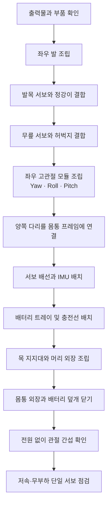

# 임시 조립 순서도 — Microduck CustomFit V0.1

> **상태: 임시 조립 안내.** 공개 Microduck 시뮬레이션 메시를 1.56배 확대해 만든 출력 세트이며, STS3215-C001 실물과 전체 체결·가동 검증은 아직 하지 않았습니다. 첫 출력은 프레임 일부로 시험 맞춤하고, 서보 축과 배선 간섭을 확인한 다음 나머지를 출력하세요.

## 전체 순서

## 단계별 임시 순서

1. **출력물 분류 및 시험 맞춤**  
   좌우 부품을 나누고 STL 이름을 확인합니다. 우선 `STS3215_C001_mount_adapter_M2_to_M3.stl`, `ankle_left/right`, `upper_leg_left/right`, `leg`, `foot_left/right`만 출력해 실제 서보와 대조합니다. 서보 케이스의 고정 구멍과 출력축 방향이 맞는지 확인하기 전에는 다리 전체를 출력하지 마세요.

2. **발 조립**  
   `sole_left/right`를 각 `foot_left/right`에 맞춥니다. TPU 접지층은 해당 모델에 포함되지 않았으므로, 미끄럼 방지 패드나 별도 TPU 밑창을 덧붙이는 방식으로 임시 처리합니다. 발목 서보의 케이블 출구와 발 안쪽 배선 통로가 서로 맞는지 확인합니다.

3. **발목·정강이 조립**  
   발목 서보를 어댑터판에 고정한 뒤 `ankle_left/right`를 연결합니다. `leg` 정강이 부품을 이어 붙이고, 발목을 움직였을 때 케이블이 꺾이거나 관절에 끼지 않는지 손으로 천천히 확인합니다.

4. **무릎·허벅지 조립**  
   무릎 서보의 축을 중립 위치로 맞춘 뒤 정강이와 `upper_leg_left/right`를 연결합니다. `upper_leg_rigidity_plate`는 해당 허벅지 부품과 맞는 방향으로 덧댑니다. 좌우 다리는 서로 거울상으로 조립합니다.

5. **고관절 모듈 조립**  
   좌우 각각에 hip yaw·roll·pitch 서보를 배치합니다. 관련 참고 부품은 `hip_l`, `yaw2roll`, `yaw_roll_motion`입니다. 이 프레임은 원본 서보 배치를 바탕으로 확대된 형상이므로, STS3215 어댑터판에 실제로 체결되는지 확인하고 필요하면 연결판을 수정해야 합니다.

6. **다리와 몸통 연결**  
   양쪽 고관절을 `trunk_base`에 고정하고 좌우 폭과 발 방향을 맞춥니다. 먼저 외장 없이 다리를 움직여 서로 닿는지 확인합니다. 다리 끝의 중립 자세가 맞지 않으면 외장을 닫지 말고 서보 영점과 브래킷 방향부터 수정합니다.

7. **배선·전자부품 배치**  
   서보 버스선을 다리 내부에서 몸통으로 올리고, 관절을 움직여도 선에 당김이나 눌림이 생기지 않게 여유를 둡니다. IMU는 몸통 중앙에 단단히 고정합니다. Pi, 서보 변환 보드, 마이크와 스피커는 각각의 실제 치수를 대조해 몸통 안에 배치합니다.

8. **배터리 트레이와 충전선**  
   `battery_tray_105x33x25.stl`에 배터리를 넣고 스트랩 슬롯을 통해 고정합니다. `battery_tray_lid.stl`은 스트랩으로 함께 고정하는 임시 덮개입니다. 충전 단자와 전원 스위치용 외장 구멍은 이 버전에 아직 없으므로, 몸통을 닫기 전에 위치를 정해 별도 가공해야 합니다.

9. **목·머리·몸통 외장**  
   `neck`, `neck_pitch` 지지대를 먼저 놓고 `top_head_shell`, `bottom_head_shell`, `face_part`, `jaw`를 맞춥니다. 현재 패키지에는 SG90 머리 구동 브래킷이 포함되지 않았으므로, 우선 머리를 고정식으로 시험 조립합니다. 목과 머리의 간섭이 없으면 `left_shell`, `right_shell`을 마지막에 닫습니다.

10. **전원 투입 전 확인**  
    서보 전원을 끈 상태에서 각 관절을 손으로 제한 범위 안에서 움직여 간섭과 케이블 끼임을 확인합니다. 이후 한 번에 모든 모터를 켜지 말고, 서보 한 개씩 ID·방향·중립 위치를 확인합니다. 다리 위에 로봇을 세우기 전에 프레임 체결과 전원 분배를 먼저 점검합니다.

## 현재 빠져 있는 확정 항목

- STS3215 10개용 전체 고하중 연결 브래킷과 좌우별 정확한 체결 방향
- SG90 머리 구동 브래킷 또는 날개 연동부
- 외장 충전 포트·전원 스위치 개구부
- 실제 나사 길이·인서트·베어링 위치와 조립 공차

이 순서는 **V0.1 부품을 안전하게 시험 맞춤하는 작업 순서**이며, 완성된 보행 로봇의 검증된 조립 매뉴얼은 아닙니다.
